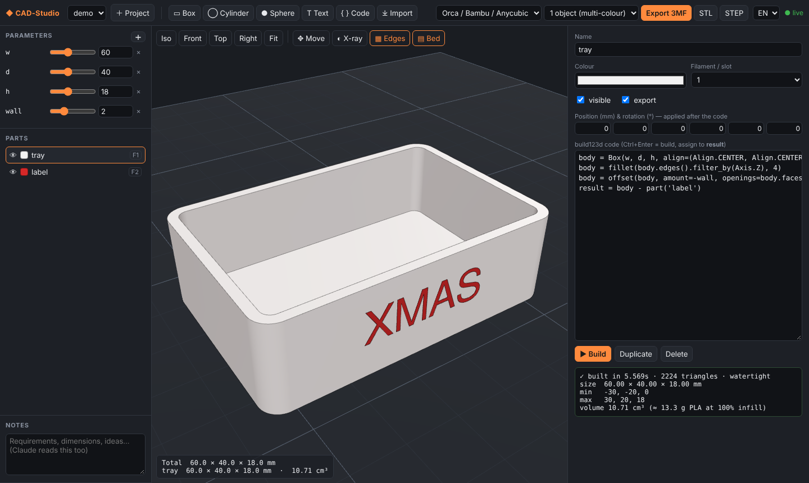

# CAD-Studio

[](https://github.com/allard-code/cadstudio/actions/workflows/ci.yml)
[](https://github.com/allard-code/cadstudio/pkgs/container/cadstudio)
[](LICENSE)

🇳🇱 [Nederlandse versie](README.nl.md)

**CAD-Studio** is a self-hosted parametric CAD editor with an **MCP server**, so Claude can design 3D-printable parts for you, check them visually and export them as **multi-colour 3MF**. The 3MF works in Orca-based slicers (OrcaSlicer, Bambu Studio, Anycubic Slicer Next) and in PrusaSlicer. Geometry is real B-rep CAD (build123d on OpenCASCADE), not meshes.



```
 Claude Code / Desktop / claude.ai ──MCP (HTTP /mcp)──►┐
                                                       │  CAD-Studio container ── /data (projects, exports, inbox)
 you, anywhere (browser, phone)    ──https (editor /)──►┘
```

- **Claude designs, you watch live.** Changes from Claude appear instantly in the browser editor, and you can tweak parameters, colours, code and position yourself.
- **Parametric.** Dimensions are project parameters with sliders. Every part is a short build123d script.
- **Claude can see its work.** `render_preview` returns a 4-view render, so Claude can check orientation, text and inlays.
- **Multi-colour for AMS / ACE Pro / MMU.** One part per colour, each with its own filament slot. The export gives one object with a per-part extruder assignment.
- **Clean meshes.** Watertight output, so the slicer doesn't need to "repair" anything. STL and STEP export too.
- **Runs anywhere.** One Docker container: editor and MCP on one port, token auth, signed download links.
- **Claude Code plugin** with a design skill. Installs in two commands.

---

## Quick start (Docker)

```bash
git clone https://github.com/allard-code/cadstudio.git && cd cadstudio
cp .env.example .env
python3 -c "import secrets; print(secrets.token_urlsafe(32))"   # put this in .env as CADSTUDIO_TOKEN
docker compose up -d --build
```

Open `http://<host>:8765` and sign in with the token.

**Without building yourself:** use the prebuilt image `ghcr.io/allard-code/cadstudio:latest`. Replace `build: .` with `image: ...` in `docker-compose.yml`; this also works as a Portainer stack.

| Variable | Default | Purpose |
|---|---|---|
| `CADSTUDIO_TOKEN` | – (required in compose) | access to the editor **and** `/mcp` |
| `CADSTUDIO_PUBLIC_URL` | `http://localhost:8765` | base URL used in download links returned to Claude |
| `CADSTUDIO_PORT` | `8765` | port inside the container |
| `PUID` / `PGID` | `1000` | owner of the files in `data/` |

Data lives in `./data` (`/data` in the container):

```
data/projects/<project>/project.json   the design: parameters + code per part
data/projects/<project>/exports/       3MF / STL / STEP
data/projects/<project>/meshes/        imported reference models
data/inbox/                            drop STL/3MF files here to import them
```

## Connect Claude

### Claude Code – plugin (recommended)

```
/plugin marketplace add allard-code/cadstudio
/plugin install cad-studio@cadstudio
```

Claude Code asks for your server URL (e.g. `http://192.168.1.50:8765`) and the token, and stores the token securely. The plugin adds the MCP connection and the `cad-design` skill.

### Claude Code – single command

```bash
claude mcp add --transport http --scope user cad-studio http://192.168.1.50:8765/mcp \
  --header "Authorization: Bearer <TOKEN>"
```

### claude.ai and the Claude mobile app

Claude connects to custom connectors from Anthropic's cloud, so the server must be reachable over **public HTTPS**. Two ways to set that up:

- a Cloudflare Tunnel;
- a reverse proxy with your own domain.

Then go to *Settings → Connectors → Add custom connector* and enter `https://cad.example.com/mcp`.

- If your account has **Request headers** (beta), add `authorization: Bearer <TOKEN>` or `x-api-key: <TOKEN>`.
- Otherwise use `https://cad.example.com/mcp?token=<TOKEN>`. Note that the token then appears in URLs and possibly in proxy logs, so use a long token.

### Claude Desktop (local, no Docker)

```bash
python -m venv .venv && .venv/bin/pip install -e .        # Windows: .venv\Scripts\pip
```

Add this to `claude_desktop_config.json` (see `claude_desktop_config.example.json`):

```json
{ "mcpServers": { "cad-studio": { "command": "/path/to/.venv/bin/python", "args": ["-m", "cadstudio", "mcp"] } } }
```

In stdio mode the editor starts automatically on `http://127.0.0.1:8765`.

## Using it

Example prompts:

- *"Make an 80×50×30 mm tray with 2 mm walls, rounded corners and my name as a red inlay on the front. Export as 3MF."*
- *"Import wagon.3mf from the inbox as a reference and design cargo that fits inside with 0.3 mm clearance."*
- *"Make the walls 1.6 mm and the text bigger, then show me a preview."*

**MCP tools:**

| Group | Tools |
|---|---|
| Projects | `list_projects`, `new_project`, `open_project`, `get_project`, `set_notes` |
| Modelling | `set_params`, `set_part`, `update_part`, `add_primitive`, `delete_part` |
| Inspecting | `measure`, `render_preview` |
| Import | `list_inbox`, `import_mesh` (inbox file or URL) |
| Export | `export_3mf`, `export_stl`, `export_step` (each with a download link) |
| Help | `get_build123d_reference`, `open_editor` |

**Editor:**

- Orbit, pan and zoom the view; click a part to select it.
- Keyboard shortcuts:

  | Key | Action |
  |---|---|
  | **G** | move the selected part with arrows |
  | **X** | X-ray view |
  | **E** | show edges |
  | **F** | fit to view |
  | **Ctrl+Enter** | build the code |

- The UI is in English and Dutch; switch with the EN/NL selector.

### Multi-colour

- Every colour is its own part with a `filament` slot (1–4; 5–8 for a second unit).
- For inlays, subtract the colour part from the base part (`result = body - part("label")`) so the volumes don't overlap.
- *Export 3MF → "1 object (multi-colour)"* writes one object with a per-part extruder in `Metadata/model_settings.config`, the same layout Bambu Studio and OrcaSlicer use. If your slicer doesn't pick up the assignment, export *separate objects* or STLs and assign the filaments manually.

## Security

**Part code is Python and runs inside the container.** Anyone who can reach the editor or `/mcp` can run code there, so:

- treat `CADSTUDIO_TOKEN` like a password;
- never expose the server without a token.

The container runs as a non-root user and only writes to `/data`. For remote access, a VPN such as Tailscale is the safest option. See [SECURITY.md](SECURITY.md).

## Limitations

- Not a full replacement for Fusion 360: there are no sketch constraints, timeline or assembly joints. Modelling is code plus parameters, which is exactly what Claude is good at.
- Imported meshes can be moved, measured and exported, and combined with your own geometry via `mesh_boolean()`
  (mesh-level union/subtract/intersect) — but not via the regular build123d `+ - &` operators, which need a
  BRep solid. A `mesh_boolean()` result can't be exported to STEP (no BRep solid), same as a plain imported mesh.
- The Docker image is built for `linux/amd64`.

## Contributing

Contributions are welcome. See [CONTRIBUTING.md](CONTRIBUTING.md), which covers the dev setup, tests, code style and how to add a UI language. Changes are tracked in [CHANGELOG.md](CHANGELOG.md).

## License

CAD-Studio is free software, licensed under the [GNU General Public License v3.0 or later](LICENSE). Bundled and used third-party components and their licenses are listed in [NOTICE](NOTICE).
