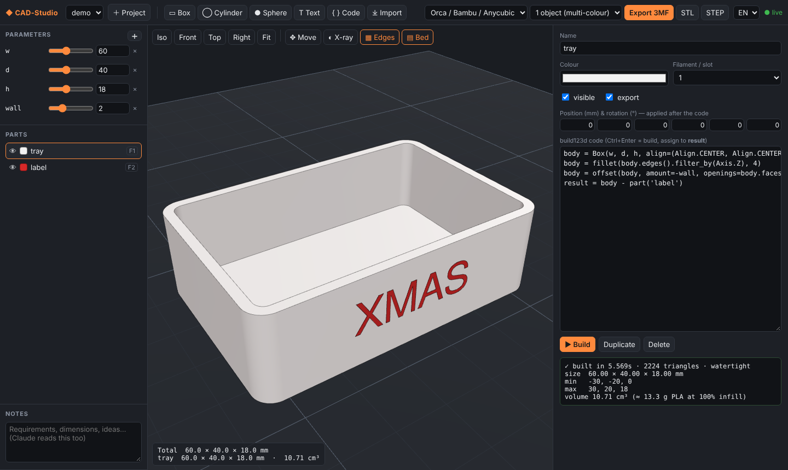

# CAD-Studio

🇬🇧 [English version](README.md)

**CAD-Studio** is een zelf-gehoste parametrische CAD-editor met een **MCP-server**. Claude kan er 3D-printbare onderdelen mee ontwerpen, ze zelf controleren en ze exporteren als **multi-color 3MF**. Die 3MF werkt in slicers op basis van Orca (OrcaSlicer, Bambu Studio, Anycubic Slicer Next) en in PrusaSlicer. De geometrie is echte CAD (build123d op OpenCASCADE), geen losse meshes.



- **Claude ontwerpt, jij kijkt live mee** in de browser-editor en past daarna zelf parameters, kleuren, code en positie aan.
- **Parametrisch**: maten zijn projectparameters met schuifjes, en elk onderdeel is een kort build123d-script.
- **Claude ziet wat het maakt**: `render_preview` geeft een render met 4 aanzichten.
- **Samenstel**: laat zien hoe de geprinte onderdelen in elkaar zitten, met doorzichtige kap, doorsnede en uit-elkaar-weergave, in de editor en als PNG.
- **Multi-color** voor AMS / ACE Pro / MMU: één onderdeel per kleur, elk met een eigen filament-slot.
- **Waterdichte meshes**, plus export naar STL en STEP.
- **Eén Docker-container**: editor en MCP op één poort, met token-beveiliging en ondertekende downloadlinks.
- **Claude Code-plugin** met een ontwerp-skill.

## Snel starten (Docker)

```bash
git clone https://github.com/allard-code/cadstudio.git && cd cadstudio
cp .env.example .env
python3 -c "import secrets; print(secrets.token_urlsafe(32))"   # zet dit in .env als CADSTUDIO_TOKEN
docker compose up -d --build
```

Open `http://<host>:8765` en log in met het token.

**Zonder zelf te bouwen:** gebruik de kant-en-klare image `ghcr.io/allard-code/cadstudio:latest`. Vervang `build: .` door `image: ...` in de compose; dat werkt ook als Portainer-stack.

Alles staat in `./data`:

| Map | Inhoud |
|---|---|
| `projects/<project>/` | ontwerp en `exports/` |
| `inbox/` | STL/3MF-bestanden om te importeren |

## Claude koppelen

**Claude Code (plugin):**
```
/plugin marketplace add allard-code/cadstudio
/plugin install cad-studio@cadstudio
```
Claude Code vraagt dan om je server-URL en het token.

**Of met één commando:**
```bash
claude mcp add --transport http --scope user cad-studio http://192.168.1.50:8765/mcp --header "Authorization: Bearer <TOKEN>"
```

**claude.ai en de Claude-app op je telefoon:** de server moet via publieke HTTPS bereikbaar zijn, bijvoorbeeld met een Cloudflare Tunnel of een reverse proxy. Voeg hem dan toe onder *Instellingen → Connectors → Add custom connector*.
- Heb je de optie "Request headers" (bèta)? Vul dan als URL `https://cad.jouwdomein.nl/mcp` in en geef het token mee als header.
- Zonder die optie gebruik je `https://cad.jouwdomein.nl/mcp?token=<TOKEN>`. Neem dan een lang token, want het staat in de URL.

**Claude Desktop lokaal, zonder Docker:** zie `claude_desktop_config.example.json`. In deze modus start de editor vanzelf mee op http://127.0.0.1:8765.

## Gebruik

Voorbeeldvraag: *"Maak een bakje van 80×50×30 mm met 2 mm wand, afgeronde hoeken en mijn naam in rood als inleg op de voorkant. Exporteer als 3MF."*

- **Multi-color:** elke kleur is een eigen onderdeel met een filament-slot (1–4; 5–8 voor een tweede unit). Een inleg trek je af van het basisonderdeel (`result = body - part("label")`).
- **Meerdere bedden:** past niet alles samen op één bed, zet onderdelen dan op een eigen printplaat. Met de
  bedbalk onder de 3D-weergave wissel je tussen bedden (ook toetsen `1`–`9`, `0` = alle); *Verdeel* zet alle
  printbare onderdelen automatisch over zoveel bedden als nodig. De 3MF-export zet elk bed als eigen plaat in één
  bestand, of met "1 bestand per bed" in losse bestanden.
- **Export "1 object (multi-color)":** elk deel krijgt een eigen extruder, op dezelfde manier als Bambu Studio en OrcaSlicer dat opslaan.
- **Printen via Home Assistant:** `slice_plate` maakt G-code, `send_to_printer` uploadt die naar Home Assistant en
  vuurt het event `cadstudio_print_request` af (met `file_id`, materiaal, printtijd en gram). Een automation kiest
  daarna het slot en start de print; zie [docs/home-assistant-print.yaml](docs/home-assistant-print.yaml). Zet
  `CADSTUDIO_HA_URL` en `CADSTUDIO_HA_TOKEN` (long-lived token van een **admin**-gebruiker).
- **Samenstel:** met `set_assembly_item` zet Claude elk onderdeel op zijn plek zoals het gemonteerd is (ook
  hulpobjecten zoals een motor of rails; die worden nooit geprint). De knop *⚙ Samenstel* onder de 3D-weergave
  toont het; per onderdeel tonen/doorzichtig, schuif *Uit elkaar*, *Doorsnede* om het open te snijden en
  *Afbeelding (PNG)* om het huidige aanzicht te downloaden. `render_assembly` / `export_assembly_png` doen
  hetzelfde voor Claude. Met `…/#assembly` open je de editor meteen in het samenstel. `check_assembly_fit` meet
  de overlap en speling tussen alle onderdelen, zodat delen die zouden klemmen vooraf opvallen.
- **Controles:** `check_floating` (zwevende delen), `check_wall_thickness` (dunne wanden) en `check_bridges`
  (te lange overspanningen die doorzakken).
- **Printvoorbereiding:** `suggest_orientation` bepaalt welke kant op het bed moet (minste support, stevige
  basis en, als je de belastingsrichting opgeeft, sterkte: geprinte delen zijn het zwakst dwars op de laaglijnen)
  en kan die oriëntatie meteen toepassen. `set_print_settings` legt printinstellingen vast op basis van waar het
  onderdeel voor is (profielen `functional`, `strong`, `watertight`, `decorative`, `draft`, `fine`), voor het
  hele project of per onderdeel. Ze komen als object-/onderdeelinstellingen in de 3MF, dus de slicer opent het
  bestand er meteen mee, en `slice_plate` gebruikt ze ook.
- **Hulpfuncties:** in elke onderdeelcode zonder import beschikbaar: `spur_gear`, `gear_centre_distance`,
  `d_hole`, `d_shaft`, `teardrop`, `pin`, `pin_hole`, `screw_boss`, `magnet_pocket` en `tolerance_coupon`
  (proefstrip met ingegraveerde spelingen).
- **Taal:** de editor is Engels- en Nederlandstalig; wissel met de EN/NL-keuze rechtsboven.

## Beveiliging

Onderdeelcode is Python die in de container draait. Behandel `CADSTUDIO_TOKEN` daarom als een wachtwoord en zet de server nooit publiek zonder token. Voor toegang van buitenaf is een VPN zoals Tailscale het veiligst. Zie [SECURITY.md](SECURITY.md).

## Licentie

[GPL-3.0-or-later](LICENSE). Je mag CAD-Studio gebruiken, aanpassen en verspreiden, maar afgeleide versies moeten ook onder de GPL blijven. Componenten van derden staan in [NOTICE](NOTICE). Bijdragen zijn welkom, zie [CONTRIBUTING.md](CONTRIBUTING.md).
